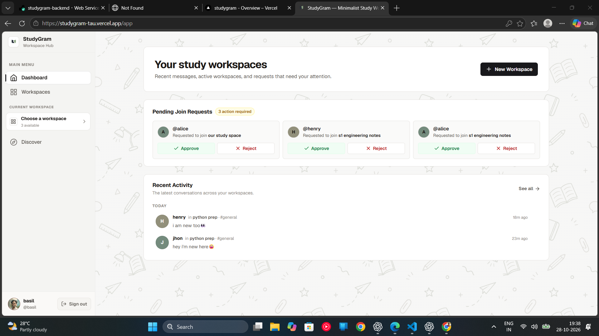
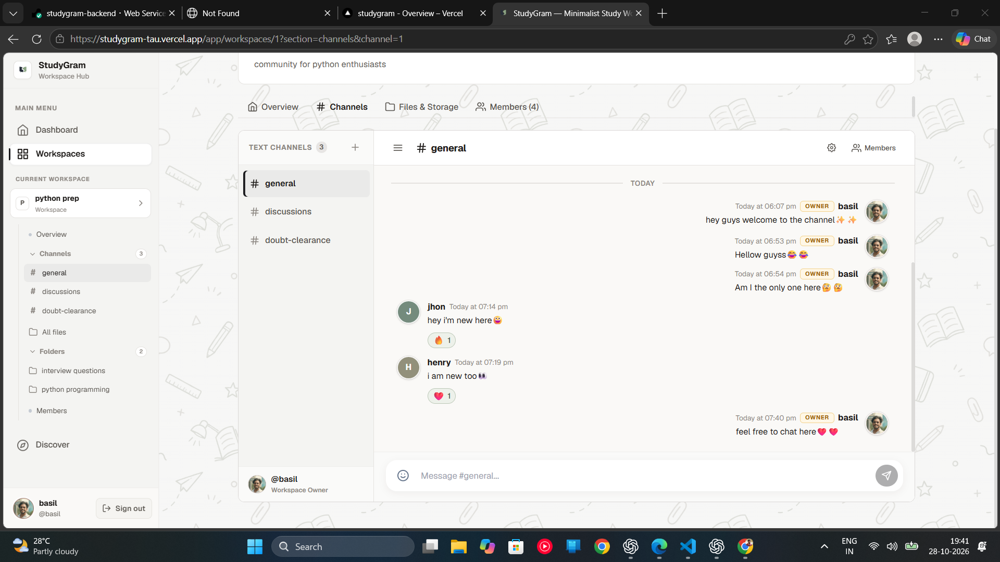
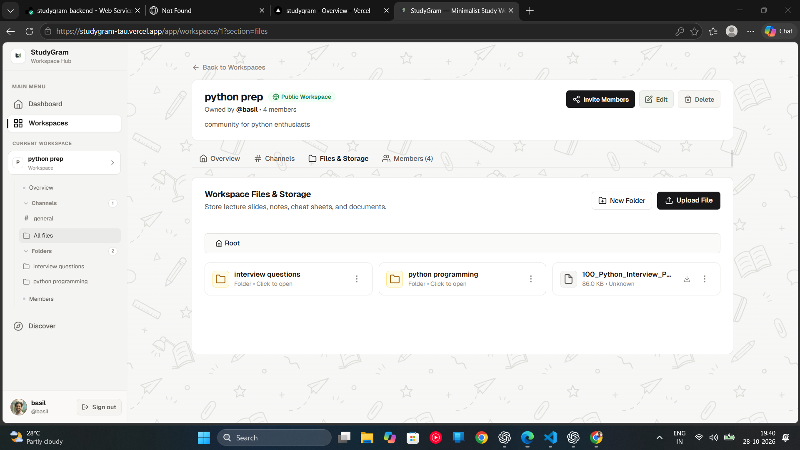
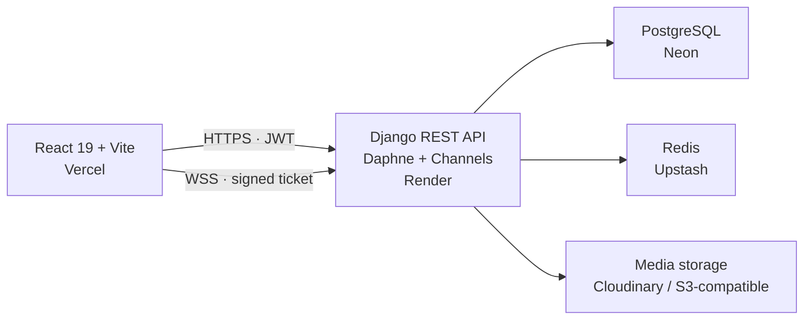

<p align="center">
  
</p>

<h1 align="center">StudyGram</h1>

<p align="center">
  A collaborative study workspace for focused group learning.<br />
  Organize resources, share ideas, and stay in sync.
</p>

<p align="center">
  <a href="https://studygram-tau.vercel.app"><strong>Open the live app →</strong></a>
  &nbsp;·&nbsp;
  <a href="https://studygram-backend.onrender.com/api/health/">API health</a>
  &nbsp;·&nbsp;
  <a href="https://github.com/n8novaa/studygram">Source code</a>
</p>

<p align="center">
  <a href="https://github.com/n8novaa/studygram/actions/workflows/ci.yml"></a>
  
  
  
</p>

## Overview

StudyGram is a full-stack collaboration app for study groups. Evolving from an earlier version of the project, the current release centers on shared workspaces, live channels, and organized study resources. Its Vercel-hosted frontend communicates with a Django REST and WebSocket backend.

Create an account in the [live application](https://studygram-tau.vercel.app) to explore. No shared demo credentials are published.

## Key features

- **Workspaces:** create public or private spaces and discover communities by topic.
- **Membership:** join requests, invitations, member roles, and workspace administration.
- **Channels:** persistent conversations with replies, reactions, and online presence.
- **Real-time messaging:** channel updates over authenticated WebSockets, with REST APIs for message operations.
- **Shared files:** nested folders, uploads, copy/move operations, and protected downloads.
- **Profiles:** display names and avatars shown across member and conversation views.
- **Account security:** JWT authentication, token refresh, sign-out, and password reset by username.

Study Rooms are not part of the current build; workspace channels are the supported messaging experience.

### Planned roadmap

Future iterations are planned to explore AI-assisted study tools and bring back live study rooms. These are roadmap ideas, not features in the current release.

## Screenshots

<p align="center">
  
</p>
<p align="center"><em>Dashboard · recent conversations and requests that need attention</em></p>

<p align="center">
  
  
</p>
<p align="center"><em>Workspace channels · shared file storage</em></p>

## Engineering highlights

- **Authorization at the API:** workspace, membership, and file permissions are checked by Django rather than relying on frontend visibility.
- **Protected file delivery:** workspace attachments are downloaded through a membership-checked Django endpoint; direct Cloudinary attachment URLs are not returned to clients.
- **Authenticated realtime:** the client obtains a short-lived signed WebSocket ticket over the API. The consumer validates the ticket and verifies current workspace membership before accepting a connection.
- **Persistent collaboration:** PostgreSQL stores workspaces, memberships, channels, messages, reactions, presence connections, and per-user channel read positions. Redis provides the shared Channels layer in production.
- **Automated checks:** GitHub Actions runs Django checks, migration-state validation, backend tests, frontend lint, Vercel configuration validation, and a production build.

## Architecture



The React client uses REST for account, workspace, channel, and file operations, and WebSockets for live channel updates and presence. Django enforces access to workspace resources and private attachment downloads. See [STUDYGRAM_ARCHITECTURE.md](STUDYGRAM_ARCHITECTURE.md) for the domain model and API map.

## Technology stack

| Area | Technologies |
| --- | --- |
| Frontend | React 19, React Router, Vite |
| Backend | Django, Django REST Framework, Simple JWT |
| Realtime infrastructure | Django Channels, Daphne, Redis / Upstash |
| Database | SQLite for local development; PostgreSQL / Neon in production |
| Storage | Local filesystem in development; Cloudinary or S3-compatible object storage in production |
| Deployment | Vercel (frontend), Render (backend), Neon (database), Upstash (Redis), Cloudinary (media), Brevo (SMTP) |

> **Storage note:** Cloudinary Free currently limits raw assets to 10 MB. StudyGram’s workspace upload validation remains 100 MiB, so files above the provider limit will be rejected by Cloudinary. See [DEPLOYMENT.md](DEPLOYMENT.md) before relying on free-tier uploads.

## Local development

### Prerequisites

- Python 3.12 or newer
- Node.js 22.12 or newer
- Redis only when testing cross-process WebSocket delivery; a single local process uses the in-memory channel layer

### Backend

From the repository root, create a virtual environment, install dependencies, and copy the development settings file:

```powershell
python -m venv .venv
.venv\Scripts\Activate.ps1
pip install -r requirements.txt
Copy-Item .env.example backend/.env
cd backend
python manage.py migrate
python manage.py runserver
```

For macOS or Linux, activate with `source .venv/bin/activate` and copy the environment template with `cp .env.example backend/.env`. Then run the Django commands from `backend/`.

The API runs at `http://127.0.0.1:8000`. Local defaults use SQLite, filesystem media, and console email. Password-reset links are printed to the backend terminal unless SMTP is configured.

### Frontend

In a second terminal, from the repository root:

```sh
cd frontend
npm ci
npm run dev
```

Vite serves the app at `http://localhost:5173`; its API client defaults to the local Django API. For a different backend, copy `frontend/.env.example` to `frontend/.env.local` and set `VITE_API_BASE_URL` to the backend API URL, including the `/api` suffix.

## Testing and validation

Run backend checks and tests from `backend/`:

```sh
python manage.py check
python manage.py test
```

Run frontend lint and build from `frontend/`:

```sh
npm run lint
npm run build
```

The same checks run in GitHub Actions on pushes and pull requests. Frontend tests are not currently part of the CI workflow; CI validates lint and the production build.

## Deployment and configuration

The deployed setup uses Vercel, Render, Neon, Upstash, Cloudinary, and Brevo. The repository includes a Docker-based backend deployment and a local Compose stack.

- Follow [DEPLOYMENT.md](DEPLOYMENT.md) for provider setup, exact environment variables, migrations, storage constraints, and smoke checks.
- Review [STUDYGRAM_ARCHITECTURE.md](STUDYGRAM_ARCHITECTURE.md) for component boundaries, domain models, routes, and known trade-offs.
- `docker compose up --build` starts the optional local PostgreSQL, Redis, Django/Daphne, and Nginx stack at `http://localhost:8080`. Compose is for local development and is not the Render deployment configuration.

## Repository structure

```text
backend/
  base/          Authentication, profiles, and health API
  workspaces/    Workspaces, memberships, channels, messages, realtime
  files/         Workspace folders, uploads, and downloads
  config/        Django settings, ASGI, and storage adapters
frontend/
  src/pages/     Application pages
  src/components/Shared and feature UI
  src/services/  API clients
  src/styles/    Application styles
docs/screenshots/ Product screenshots used in this README
```

## Contributing

See [CONTRIBUTING.md](CONTRIBUTING.md) for the development workflow, checks, and pull-request expectations. Keep secrets, `.env` files, database dumps, and private uploads out of commits.

## License

This repository does not currently include a `LICENSE` file. No open-source reuse terms are granted by this README.
